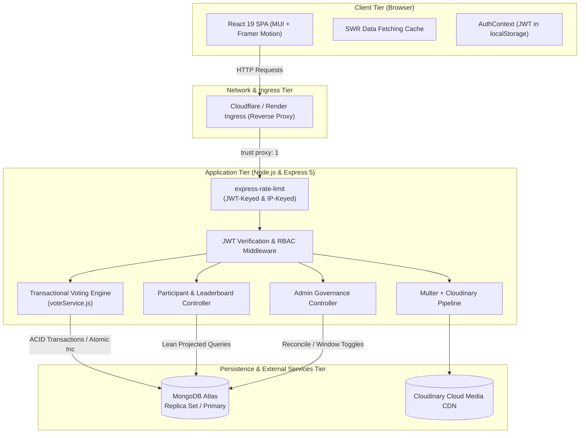
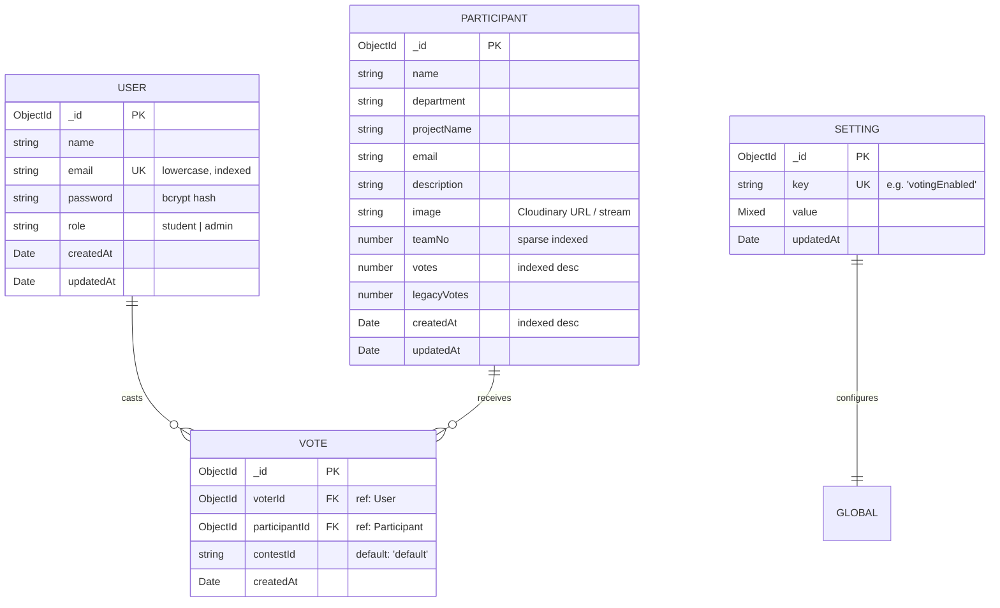
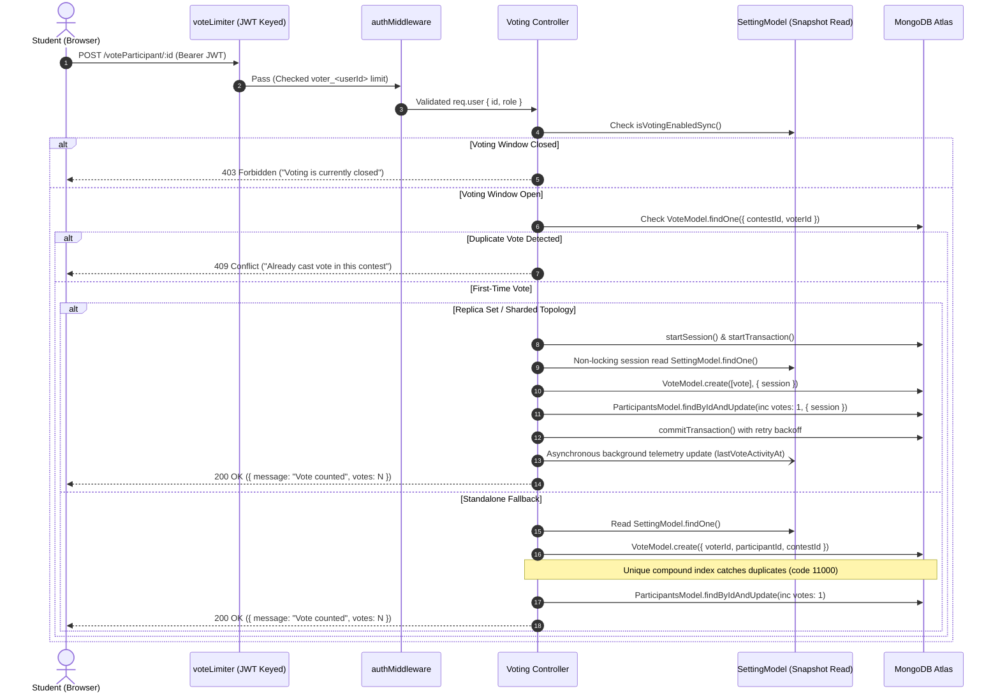

# 🏛️ ExpoVote System Architecture & Technical Specifications

**ExpoVote** (Gandhigiri / AITM Rating Portal) is a full-stack, production-grade event evaluation and voting platform engineered for academic exhibitions, hackathons, and project showcases at Angadi Institute of Technology and Management (AITM).

---

## 📑 Table of Contents
1. [System Overview & High-Level Architecture](#1-system-overview--high-level-architecture)
2. [Architectural Diagram](#2-architectural-diagram)
3. [Frontend Architecture (`/frontend`)](#3-frontend-architecture-frontend)
4. [Backend Architecture (`/backend`)](#4-backend-architecture-backend)
5. [Database Architecture & Data Models](#5-database-architecture--data-models)
6. [Core Engine Workflows](#6-core-engine-workflows)
   - [Authentication & RBAC](#authentication--rbac)
   - [Distributed Atomic Voting Engine](#distributed-atomic-voting-engine)
   - [Image Pipeline & CDN Streaming](#image-pipeline--cdn-streaming)
   - [Admin Window & Ledger Reconciliation](#admin-window--ledger-reconciliation)
7. [Security & Network Resilience Architecture](#7-security--network-resilience-architecture)
8. [Directory Structure](#8-directory-structure)
9. [Deployment Topology & Environment Configuration](#9-deployment-topology--environment-configuration)

---

## 1. System Overview & High-Level Architecture

ExpoVote is built on a decoupled client-server architecture utilizing **React.js** for the frontend user interface, **Express.js (Node.js)** for the backend REST API, **MongoDB Atlas** as the persistence store, and **Cloudinary** for image transformation and CDN hosting.

### Key Capabilities
- **Role-Based Access Control (RBAC):** Distinct roles for Students (`student`) and Organizers/Faculty (`admin`).
- **High-Concurrency Voting Engine:** Guaranteed single-vote idempotency per user per contest, backed by MongoDB multi-document transactions and unique compound indexing.
- **Campus Wi-Fi NAT Immunity:** Rate limiters keyed by cryptographically verified JWT voter IDs rather than shared public IP addresses, preventing false-positive throttling on institutional Wi-Fi networks.
- **Infinite Scroll & Virtualized Feeds:** Optimized SWR data fetching with lean projections and paginated queries (default max 50 items/page).
- **Graceful Fail-Closed Governance:** Administrative toggles to open/close voting windows dynamically with immediate in-memory and database-enforced cutoffs.

---

## 2. Architectural Diagram



---

## 3. Frontend Architecture (`/frontend`)

The frontend is a Single-Page Application (SPA) built on **React 19** and structured with responsive UI components, route protections, and client-side caching.

### 3.1 Technology Stack
- **Framework:** React 19 (`react`, `react-dom`)
- **Routing:** React Router v7 (`react-router-dom`)
- **UI Components:** Material-UI v7 (`@mui/material`, `@mui/icons-material`, `@emotion/react`, `@emotion/styled`) & Bootstrap 5
- **Animations:** Framer Motion (`framer-motion`) & Animate.css
- **Data Caching & Infinite Scroll:** SWR (`swr/infinite`)
- **HTTP Client:** Axios (`axios`)
- **Notifications:** React-Toastify (`react-toastify`)
- **Viewport Detection:** React Intersection Observer (`react-intersection-observer`)

### 3.2 Component Hierarchy & Routing
Routes are defined in `src/App.js` with declarative protection:

```
App
├── Navbar (Branding, Navigation Links, Auth State display)
├── Route Container
│   ├── / (HomePage - Hero banner, Announcements, EventTimeline, FAQ, Gallery)
│   ├── /participants (ParticipantsPage - Infinite scroll grid, project search, share dialogs)
│   ├── /winners (WinnerPage - Live leaderboard, vote distribution progress bars)
│   ├── /login (Login - JWT token acquisition)
│   ├── /signup (Signup - Student account creation)
│   ├── /about (AboutPage - Event history & institutional background)
│   ├── /contact (Contact - Contact form & support channels)
│   ├── /register [Private: student/admin] (Register - Participant submission form with image upload)
│   └── /admin [Private: admin only] (AdminPanel - Participant curation, voting window controls, ledger reconciliation)
└── Footer (Campus branding, copyright, quick links)
```

### 3.3 State Management & Data Strategies
1. **Authentication State (`AuthContext.js`):**
   - Manages the active JWT stored in `localStorage`.
   - Exposes `login(jwt)`, `logout()`, and current token state to the entire tree.
2. **Access Control (`PrivateRoute.js`):**
   - Inspects JWT expiration and decoding using `jwt-decode`.
   - Checks `decoded.role === 'admin'` when `adminOnly={true}` is configured, redirecting unauthenticated or unauthorized users automatically.
3. **Infinite Pagination & Caching:**
   - Uses `useSWRInfinite` with keys matching backend pagination: `/allParticipants?page={index}&limit=6` and `/allParticipantsByVotes?page={index}&limit=6`.
   - Employs `revalidateFirstPage: false` and `revalidateOnFocus: false` to eliminate excessive network roundtrips during intense voting periods.
4. **Lazy Image Loading:**
   - Custom `LazyImage` wrapper utilizing `react-intersection-observer` with a `300px` root margin for progressive blur-to-sharp transitions, reducing initial layout thrashing.

---

## 4. Backend Architecture (`/backend`)

The backend is built with **Node.js** and **Express 5**, using a modular layered pattern separating routing, middleware, domain services, and database schemas.

### 4.1 Technology Stack
- **Runtime:** Node.js (CommonJS modules)
- **Web Framework:** Express.js 5 (`express`)
- **ODM:** Mongoose 8 (`mongoose`)
- **Security & Cryptography:** `bcryptjs` (password salting with 10 rounds), `jsonwebtoken` (HMAC-SHA256 signatures)
- **Asset Processing:** `multer`, `cloudinary`, `multer-storage-cloudinary`
- **Rate Limiting:** `express-rate-limit`
- **Reverse Proxy Support:** Express `trust proxy: 1` enabled for accurate client IP resolution behind Cloudflare/Render load balancers.

### 4.2 Middleware Layer

| Middleware | File | Purpose | Configuration / Limits |
| :--- | :--- | :--- | :--- |
| **`authMiddleware`** | `middleware/auth.js` | Validates `Bearer <token>` HTTP header, decodes user payload into `req.user`. | Rejects expired/malformed tokens with `401 Unauthorized`. |
| **`adminOnly`** | `middleware/auth.js` | Enforces administrator privileges (`req.user.role === 'admin'`). | Returns `403 Forbidden` if user is not an administrator. |
| **`authLimiter`** | `middleware/rateLimiter.js` | Throttles brute-force attempts on `/login` and `/signup`. | 15 attempts per 15-minute window per IP. |
| **`uploadLimiter`** | `middleware/rateLimiter.js` | Protects Cloudinary upload bandwidth before file streams reach Multer. | 10 uploads per 15-minute window per IP. |
| **`voteLimiter`** | `middleware/rateLimiter.js` | Rate limits voting bursts without penalizing campus Wi-Fi shared IPs. | **Keyed by `voter_${req.user.id}`** (30 requests/minute). |
| **`readLimiter`** | `middleware/rateLimiter.js` | Protects read-heavy public endpoints (`/allParticipants`, `/allParticipantsByVotes`). | 120 requests/minute per IP. |
| **`handleUpload`** | `middleware/upload.js` | Filters MIME types, checks size limit, streams image directly to Cloudinary. | Max 2MB, allowed: JPEG, PNG, WEBP, GIF. |

---

## 5. Database Architecture & Data Models

All data is structured in MongoDB via Mongoose models with strict index declarations matching actual production access patterns.



### 5.1 Indexes and Performance Optimizations
1. **`User` Model (`models/userModel.js`):**
   - `{ email: 1 }` with `{ unique: true }`: Ensures instantaneous login lookups and eliminates duplicate registrations.
   - `{ role: 1, createdAt: -1 }`: Eliminates `COLLSCAN` and in-memory blocking `SORT` on administrative queries (`/admin/listAdmins`).
2. **`ParticipantsModel` (`schemas/participantsSchema.js`):**
   - `{ votes: -1, _id: 1 }`: Covers the Leaderboard query (`/allParticipantsByVotes`) without requiring in-memory sorting.
   - `{ createdAt: -1, _id: 1 }`: Covers the Participant Gallery feed (`/allParticipants`).
   - `{ teamNo: 1 }` with `{ sparse: true }`: Enables rapid team lookups while permitting null values.
3. **`VoteModel` (`models/voteModel.js`):**
   - **Compound Unique Index:** `{ contestId: 1, voterId: 1 }` with `{ unique: true }`.
     - **Database-Level Guarantee:** Physically prevents any user from casting more than one vote per contest, even under concurrent multi-threaded requests.
   - `{ participantId: 1 }`: Enables rapid deletion cascade when removing participants (`/deleteParticipant/:id`).
   - `{ contestId: 1, participantId: 1 }`: Covered aggregation index (`PROJECTION_COVERED`) for `reconcileVotes`, eliminating disk document fetch during ledger reconciliation.
4. **`SettingModel` (`models/settingModel.js`):**
   - `{ key: 1 }` with `{ unique: true }`: Fast key-value store for application settings (e.g., `votingEnabled`).

---

## 6. Core Engine Workflows

### Authentication & RBAC
1. **Student Registration (`POST /signup`):** The user role is strictly hardcoded to `student` on the server, guaranteeing that clients cannot self-promote to `admin`. Password hashing occurs in a Mongoose `pre('save')` hook with salt rounds = 10.
2. **Admin Authentication & Registration:**
   - **Dedicated Admin Login (`/admin/login`):** An isolated portal for authorized administrators with strict role verification.
   - **Admin Signup Portal (`/admin/signup` & `POST /admin/signup`):** Dedicated registration portal for event organizers and faculty. Supports automated account creation or upgrading existing accounts to administrator status, with optional `ADMIN_SECRET_KEY` institutional passcode protection.
   - **In-Dashboard Admin Provisioning (`POST /admin/registerAdmin`):** Existing logged-in administrators can also provision, promote, or register new administrators directly from the Admin Dashboard modal.
   - **Initial Root Admin CLI Provisioning:**
     ```bash
     node scripts/createAdmin.js <email> <password> [name]
     ```
3. **Token Issuance:** On successful authentication (`POST /login` or `POST /admin/signup`), a signed JWT containing `{ id, email, role: "admin" }` is returned with a 7-day expiration. Admins are automatically routed to the `/admin` dashboard.

---

### Distributed Atomic Voting Engine
Voting (`POST /voteParticipant/:id`) executes with strict ACID compliance, adapting dynamically to the underlying MongoDB topology without single-document serialization bottlenecks:



---

### Image Pipeline & CDN Streaming
1. **Direct Uploads:**
   - Multi-part requests (`POST /addParticipants`) pass through `uploadLimiter`.
   - Multer streams file buffers directly to Cloudinary folder `expovote/participants` using `multer-storage-cloudinary`.
   - File size is capped at 2MB; non-image MIME types are rejected immediately.
2. **Base64 Legacy Protection (`/participantImage/:id`):**
   - To prevent megabyte-scale Base64 strings from bloating JSON responses on `/allParticipants`, the server substitutes raw Base64 payloads with a streaming proxy URL:
     ```
     https://<host>/participantImage/<participantId>
     ```
   - The streaming endpoint uses high-performance substring and index scanning (avoiding CPU-intensive regex backtracking on multi-megabyte payloads), extracts the binary buffer, and responds with appropriate `Content-Type` and `Cache-Control: public, max-age=86400` (24-hour browser caching).

---

### Admin Window & Ledger Reconciliation
- **Window Controls:** Administrators can toggle voting status at runtime via `POST /admin/startVoting` and `POST /admin/stopVoting`. Changes are updated synchronously in memory (`isVotingEnabledSync`) and persisted to the `Setting` collection.
- **High-Throughput Ledger Reconciliation (`POST /admin/reconcileVotes`):**
  - If a server crash occurs mid-flight, the administrator can invoke the reconciliation service (`services/voteService.js`).
  - Aggregates canonical vote counts per participant from `VoteModel` via MongoDB aggregation pipeline.
  - Fetches participant counters with lean projections (`{ _id: 1, votes: 1, legacyVotes: 1 }`).
  - Dispatches updates in a **single non-blocking network roundtrip** using unordered `ParticipantsModel.bulkWrite(bulkOps, { ordered: false })`, replacing inefficient serial database updates.

---

## 7. Security & Network Resilience Architecture

### 7.1 Campus Wi-Fi NAT Defense
In an on-campus expo or hackathon, hundreds of students connect through the same institutional public Wi-Fi gateway (sharing one public IP). Traditional IP-based rate limiting immediately blocks all students after the first few submissions.
- **ExpoVote Solution:**
  - `voteLimiter`: Extracts the authenticated JWT voter ID (`voter_${req.user.id}`) as the rate-limiting key.
  - `readLimiter`: Safely inspects Bearer tokens to assign distinct keys (`reader_${decoded.id}`) for authenticated students, while raising the anonymous IP threshold to `1,200 req/min` to protect public browsing.
  - HTTP Caching: Public read endpoints (`/allParticipants`, `/allParticipantsByVotes`) return `Cache-Control: public, max-age=5, stale-while-revalidate=10`, dramatically reducing load on the database during traffic spikes.

### 7.2 Defense-in-Depth Measures
- **Strict Role Elevation Guard:** No API route permits a client to modify user roles. Admin privileges are set exclusively via the CLI script or authorized in-dashboard admin provisioning.
- **Threadpool Scaling:** `UV_THREADPOOL_SIZE` is initialized to 64 to prevent `bcrypt` password hashing from starving asynchronous I/O threads.
- **Connection Pool Tuning:** Mongoose configured with `maxPoolSize: 150`, `minPoolSize: 10`, and `maxIdleTimeMS: 30000` to handle high concurrency during live exhibition voting rounds.
- **Image Quota Preservation:** `uploadLimiter` executes *before* `multer`, preventing attackers from exhausting Cloudinary bandwidth quotas with rapid multipart uploads.
- **Metadata Document Counting:** Pagination counts utilize $O(1)$ `estimatedDocumentCount()` instead of full collection scans.

---

## 8. Directory Structure

```
expovote/
├── ARCHITECTURE.md                 # System Architecture & Technical Specifications
├── README.md                       # Project overview and runbook
├── backend/                        # Node.js / Express 5 API Server
│   ├── .env.example                # Sample environment configuration
│   ├── .gitignore                  # Backend file ignore patterns
│   ├── index.js                    # Express application entrypoint & routing
│   ├── package.json                # Dependencies and lifecycle scripts
│   ├── render.yaml                 # Render web service deployment blueprint
│   ├── middleware/                 # Express middleware modules
│   │   ├── auth.js                 # JWT verification & adminOnly guard
│   │   ├── rateLimiter.js          # In-memory rate limiting policies
│   │   └── upload.js               # Multer + Cloudinary storage configuration
│   ├── models/                     # Mongoose model definitions
│   │   ├── participantsModels.js   # Participant model export
│   │   ├── settingModel.js         # Key-value system configuration model
│   │   ├── userModel.js            # User authentication model & password hooks
│   │   └── voteModel.js            # Canonical vote ledger model & indexes
│   ├── schemas/                    # Mongoose schema definitions
│   │   └── participantsSchema.js   # Participant schema with compound indexes
│   ├── scripts/                    # Administrative CLI utilities
│   │   └── createAdmin.js          # Secure admin provisioning script
│   └── services/                   # Business domain services
│       └── voteService.js          # Voting state synchronization & ledger reconciliation
└── frontend/                       # React 19 Single Page Application
    ├── package.json                # Frontend dependencies & scripts
    ├── public/                     # Static assets, logos, and index.html
    └── src/                        # Application source code
        ├── api.js                  # Axios base URL configuration
        ├── App.js                  # Application root & React Router configuration
        ├── index.css               # Global stylesheets & design system tokens
        ├── index.js                # React DOM entrypoint
        ├── components/             # Reusable UI & infrastructure components
        │   ├── Announcements.js    # Event announcements ticker
        │   ├── AuthContext.js      # Global React Authentication context
        │   ├── axiosSetup.js       # Interceptor configuration
        │   ├── EventTimeline.js    # Exhibition schedule timeline
        │   ├── FAQ.js              # Frequently asked questions accordion
        │   ├── Footer.js           # Institutional footer component
        │   ├── Gallery.js          # Project showcase gallery
        │   ├── Header.js           # Header navigation banner
        │   ├── Navbar.js           # Responsive navigation bar
        │   └── PrivateRoute.js     # Route guard for authenticated & admin views
        └── Page/                   # Page views
            ├── AboutPage.js        # Institutional about page
            ├── AdminLogin.js       # Dedicated administrator login portal
            ├── AdminPanel.js       # Admin participant & voting management
            ├── Contact.js          # Support & inquiry page
            ├── HomePage.js         # Landing page hero & features
            ├── Login.js            # User login view
            ├── Logout.js           # User logout handler
            ├── ParticipantsPage.js # Participant grid with infinite scrolling
            ├── Register.js         # Project registration form
            ├── Signup.js           # Student account registration
            └── WinnerPage.js       # Real-time leaderboard view
```

---

## 9. Deployment Topology & Environment Configuration

### 9.1 Hosting Architecture
- **Frontend:** Static web application hosting (Render Static Site / Vercel / Netlify / GitHub Pages).
- **Backend:** Render Web Service (Node.js runtime, single-instance with `trust proxy: 1`).
- **Database:** MongoDB Atlas (M0 / M10+ tier with automatic replica sets for transaction support).
- **Media CDN:** Cloudinary Cloud Media Services.

### 9.2 Backend Environment Variables (`backend/.env`)

```ini
# Server Configuration
PORT=5000
NODE_ENV=production

# Database
MONGO_URL=mongodb+srv://<username>:<password>@<cluster>.mongodb.net/ratingdb?retryWrites=true&w=majority

# Authentication
JWT_SECRET=your_super_secret_jwt_key_min_32_characters

# CORS Whitelist
FRONTEND_URL=https://your-frontend-domain.com

# Cloudinary Integration
CLOUDINARY_CLOUD_NAME=your_cloud_name
CLOUDINARY_API_KEY=your_api_key
CLOUDINARY_API_SECRET=your_api_secret

# High Concurrency & Connection Pooling (Optional)
MONGO_MAX_POOL_SIZE=150
MONGO_MIN_POOL_SIZE=10
UV_THREADPOOL_SIZE=64

# Rate Limit Overrides (Optional)
RATE_LIMIT_AUTH_MAX=15
RATE_LIMIT_UPLOAD_MAX=10
RATE_LIMIT_VOTE_MAX=30
RATE_LIMIT_READ_MAX=1200
```

### 9.3 Frontend Environment Variables (`frontend/.env`)

```ini
REACT_APP_API_URL=https://your-backend-domain.onrender.com
```

---
*Document Version: 1.0.0 • Maintained for ExpoVote / AITM Rating Platform*
